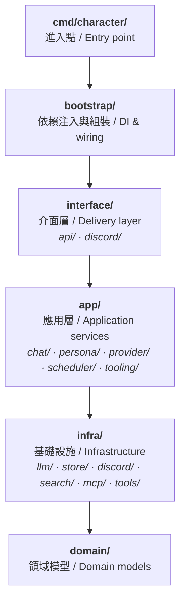
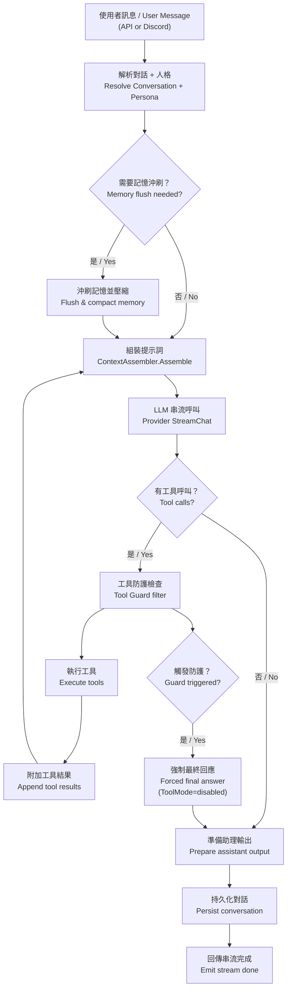
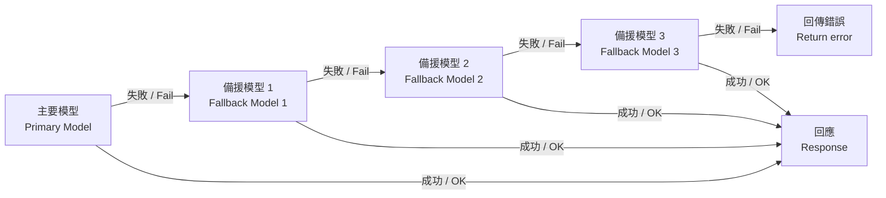
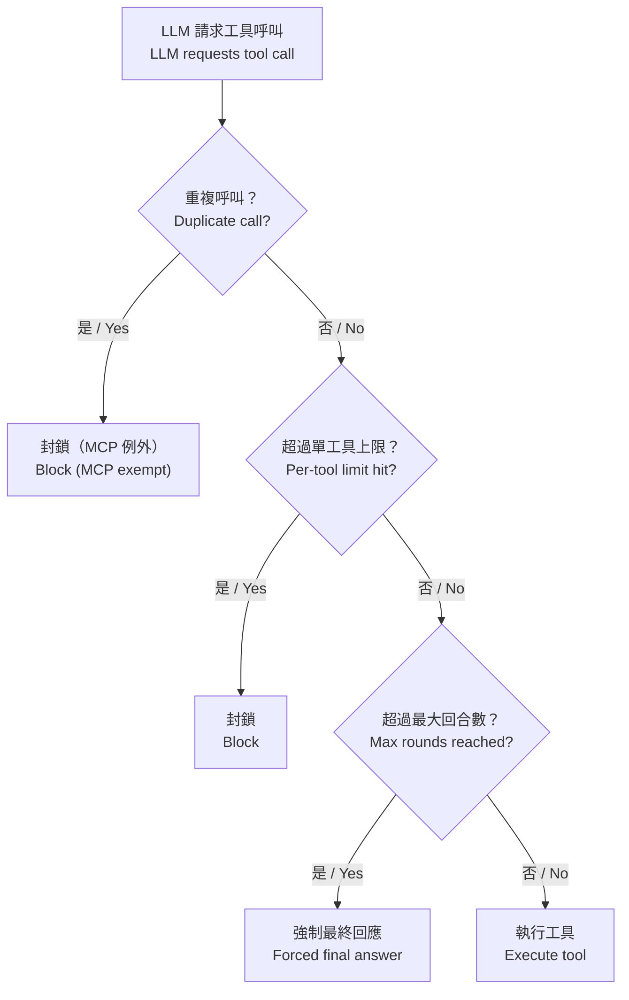

# KoukeBOT

> AI 驅動的 Discord 機器人，搭配 Web 管理介面
> AI-powered Discord bot with a web management UI


---

## 功能特色 / Features

- **LLM 對話 / LLM Chat** — 整合 Google Gemini，支援串流回應與工具呼叫迴圈
  Integrates Google Gemini with streaming responses and tool-calling loops
- **Discord 機器人 / Discord Bot** — 支援頻道訊息、私訊、斜線指令、圖片附件
  Guild messages, DMs, slash commands, and image attachments
- **人格系統 / Persona System** — 以 YAML + Markdown 定義多重 AI 人格，可熱載入
  Multiple AI personas defined via YAML + Markdown, hot-reloadable at runtime
- **工具系統 / Tool System** — 內建網頁搜尋、網頁擷取、檔案讀寫、排程任務、Discord 觀測
  Built-in web search, web fetch, file I/O, scheduled tasks, Discord observe
- **MCP 整合 / MCP Integration** — 透過 Model Context Protocol 動態載入外部工具
  Dynamically load external tools via Model Context Protocol
- **多模態 / Multimodal** — 支援文字 + 圖片的混合對話
  Text + image mixed conversations
- **記憶管理 / Memory Management** — 上下文摘要、對話壓縮、長期記憶萃取
  Context digests, conversation compaction, and long-term memory extraction
- **Web 管理介面 / Web UI** — React 前端，提供即時聊天、設定管理、MCP 設定
  React frontend for real-time chat, settings management, and MCP configuration
- **多供應商容錯 / Multi-Provider Fallback** — 支援最多三層備援模型鏈
  Up to three-level fallback model chains
- **請求佇列 / Request Queue** — 自動佇列化處理並發請求，搭配暫態錯誤恢復
  Automatic queueing with transient error recovery

---

## 架構概覽 / Architecture

本專案採用 Clean Architecture 分層設計：
The project follows a Clean Architecture layered design:



**層級規則 / Layer rules**：上層可依賴下層，下層不得反向依賴上層。
Upper layers depend on lower layers; lower layers never depend upward.

### 聊天管線 / Chat Pipeline

從使用者訊息到助理回應的完整處理流程：
End-to-end flow from user message to assistant response:



### 供應商容錯 / Provider Fallback

當主要模型發生錯誤時的自動容錯流程：
Automatic failover when the primary model encounters an error:



---

## 技術棧 / Tech Stack

### 後端 / Backend

| 技術 / Technology | 用途 / Purpose |
|---|---|
| Go 1.25 | 主要語言 / Primary language |
| `google.golang.org/genai` | Google Gemini API 整合 / Gemini API integration |
| `github.com/bwmarrin/discordgo` | Discord 機器人框架 / Discord bot framework |
| `golang.org/x/oauth2` | OAuth 2.0 認證流程 / OAuth 2.0 authentication |
| `gopkg.in/yaml.v3` | 人格設定檔解析 / Persona config parsing |
| `github.com/go-shiori/go-readability` | 網頁內容擷取 / Web content extraction |
| `html-to-markdown` | HTML 轉 Markdown / HTML to Markdown conversion |

### 前端 / Frontend

| 技術 / Technology | 用途 / Purpose |
|---|---|
| React 19 + TypeScript | UI 框架 / UI framework |
| Vite 7 | 建置工具 / Build tool |
| Monaco Editor | 程式碼編輯器元件 / Code editor component |
| React Router 7 | 路由管理 / Routing |
| react-markdown | Markdown 渲染 / Markdown rendering |

---

## 專案結構 / Project Structure

```
KoukeBOT/
├── cmd/character/           # 應用程式進入點 / Application entry point
├── internal/
│   ├── domain/              # 領域模型（純業務實體）/ Domain models
│   ├── app/                 # 應用服務層 / Application services
│   │   ├── chat/            # 聊天管線與工具迴圈 / Chat pipeline & tool loop
│   │   ├── persona/         # 人格生命週期管理 / Persona lifecycle
│   │   ├── provider/        # LLM 供應商池與選擇 / Provider pool & selection
│   │   ├── scheduler/       # 排程任務引擎 / Scheduled task engine
│   │   └── tooling/         # 工具目錄與模式 / Tool catalog & modes
│   ├── infra/               # 基礎設施轉接器 / Infrastructure adapters
│   │   ├── llm/             # LLM 供應商實作 / LLM provider implementations
│   │   ├── store/           # 對話持久化 / Conversation persistence
│   │   ├── discord/         # Discord 適配層 / Discord adapter
│   │   ├── search/          # 網頁搜尋（Brave, Perplexity）/ Web search
│   │   ├── mcp/             # Model Context Protocol 客戶端 / MCP client
│   │   ├── tools/           # 工具實作 / Tool implementations
│   │   ├── config/          # 設定儲存 / Settings storage
│   │   └── logger/          # 結構化日誌 / Structured logging
│   ├── interface/           # 介面層 / Delivery layer
│   │   ├── api/             # HTTP REST API 處理器 / HTTP handlers
│   │   └── discord/         # Discord 事件處理器 / Discord event handlers
│   ├── bootstrap/           # 依賴注入與啟動組裝 / DI & startup wiring
│   └── util/                # 通用工具 / Shared utilities
├── configs/personas/        # 人格設定檔 / Persona configurations
├── data/                    # 執行期資料 / Runtime data
├── web/                     # React 前端 / React frontend
├── docs/                    # 架構文件 / Architecture documentation
├── k8s/                     # Kubernetes 部署清單 / K8s manifests
├── scripts/                 # 建置與驗證腳本 / Build & verification scripts
├── Dockerfile               # 多階段建置 / Multi-stage build
├── docker-compose.yml       # 容器編排 / Container orchestration
└── Makefile                 # 建置指令 / Build targets
```

---

## 快速開始 / Getting Started

### 前置需求 / Prerequisites

- Go 1.25+ （後端建置 / backend build）
- Node.js 22+ （前端建置 / frontend build）
- Docker（選用 / optional）

### 本機開發 / Local Development

```bash
# 建置 Go 二進位檔 / Build Go binary
make build

# 啟動後端伺服器（預設 :8080）/ Start backend server (default :8080)
make run

# 另開終端，啟動前端開發伺服器 / In another terminal, start frontend dev server
make web-dev

# 或一鍵啟動後端 + 前端 / Or start both together
make dev
```

### Docker

```bash
# 建置映像檔並啟動 / Build image and start
docker-compose up -d

# 檢視日誌 / View logs
docker-compose logs -f

# 停止 / Stop
docker-compose down
```

### Kubernetes

```bash
# 部署到叢集 / Deploy to cluster
make k8s-deploy

# 更新既有部署 / Update existing deployment
make k8s-update

# 檢視狀態 / Check status
make k8s-status

# 轉發埠號到本機 / Port forward to localhost
make k8s-port-forward
```

---

## 設定 / Configuration

### 執行期設定 / Runtime Settings

所有設定存放於 `data/settings.json`，可透過 Web UI 或 API 修改：
All settings are stored in `data/settings.json`, configurable via Web UI or API:

| 設定項 / Setting | 說明 / Description |
|---|---|
| `provider_type` | 供應商類型：`api-key` 或 `oauth` / Provider type |
| `provider_id` | 供應商 ID（`gemini-api-key`, `openai-api-key`, `google-gemini-cli`, `google-antigravity`, `aistudio-rpc`） |
| `model_id` | 模型 ID / Model identifier |
| `gemini_api_key` | Gemini API 金鑰 / Gemini API key |
| `discord_token` | Discord 機器人權杖 / Discord bot token |
| `brave_api_key` | Brave Search API 金鑰 / Brave Search API key |
| `web_tool_mode` | 網頁工具模式：`classic` 或 `playwright_mcp` / Web tool mode |
| `tool_guard_enabled` | 是否啟用工具防護機制 / Enable tool guard |
| `max_tool_rounds` | 每輪最大工具呼叫回合數（預設 5）/ Max tool rounds per turn |
| `memory_recent_rounds` | 保留的最近對話回合數（預設 50）/ Recent rounds to keep |
| `fallback_enabled` | 是否啟用備援模型 / Enable fallback models |

### 人格設定 / Persona Configuration

每個人格放在 `configs/personas/{persona-id}/` 目錄下：
Each persona lives under `configs/personas/{persona-id}/`:

```
configs/personas/{persona-id}/
├── config.yaml      # 中繼資料、系統提示詞範本、生成參數
│                    # Metadata, system prompt template, generation params
├── lore.md          # 背景知識 / Background knowledge
├── user.md          # 使用者描述檔 / User profile context
├── anchors.yaml     # 風格範例（few-shot）/ Style examples (few-shot)
└── memory/
    ├── MEMORY.md    # 長期記憶 / Long-term memory
    └── YYYY-MM-DD.md  # 每日記憶紀錄 / Daily memory logs
```

### 環境變數 / Environment Variables

| 變數 / Variable | 預設值 / Default | 說明 / Description |
|---|---|---|
| `GIN_MODE` | `release` | 伺服器模式 / Server mode |
| `TZ` | `Asia/Tokyo` | 時區 / Timezone |
| `PLAYWRIGHT_BROWSERS_PATH` | `/ms-playwright` | Playwright 瀏覽器路徑 / Browser path |
| `GEMINI_API_KEY` | - | Gemini API 金鑰（API key 模式）/ Gemini API key (API-key mode) |
| `GEMINI_MODEL` | - | Gemini 模型覆寫 / Gemini model override |
| `OPENAI_API_KEY` | - | OpenAI API 金鑰（API key 模式）/ OpenAI API key (API-key mode) |
| `OPENAI_MODEL` | - | OpenAI 模型覆寫 / OpenAI model override |

---

## API 端點 / API Endpoints

基礎路徑 / Base path: `/api/`

### 人格 / Personas

| 方法 / Method | 路徑 / Path | 說明 / Description |
|---|---|---|
| `GET` | `/api/personas` | 列出所有人格 / List all personas |
| `GET` | `/api/personas/{id}` | 取得人格詳情 / Get persona details |
| `PUT` | `/api/personas/{id}` | 更新人格 / Update persona |
| `POST` | `/api/personas/reload` | 從磁碟重新載入 / Reload from disk |

### 聊天 / Chat

| 方法 / Method | 路徑 / Path | 說明 / Description |
|---|---|---|
| `POST` | `/api/chat` | 同步聊天（回傳完整回應）/ Sync chat |
| `GET/POST` | `/api/chat/stream` | 串流聊天（SSE）/ Streaming chat (SSE) |

### 對話 / Conversations

| 方法 / Method | 路徑 / Path | 說明 / Description |
|---|---|---|
| `GET` | `/api/conversations` | 列出所有對話 / List all conversations |
| `POST` | `/api/conversations` | 建立對話 / Create conversation |
| `GET` | `/api/conversations/{channelID}/{personaID}` | 依頻道+人格取得 / Get by channel+persona |
| `DELETE` | `/api/conversations/{channelID}/{personaID}` | 依頻道+人格刪除 / Delete by channel+persona |
| `GET` | `/api/conversations/by-id/{id}` | 依 ID 取得 / Get by ID |
| `DELETE` | `/api/conversations/by-id/{id}` | 依 ID 刪除 / Delete by ID |

### 設定 / Settings

| 方法 / Method | 路徑 / Path | 說明 / Description |
|---|---|---|
| `GET` | `/api/settings` | 取得所有設定 / Get all settings |
| `PUT` | `/api/settings` | 更新設定 / Update settings |
| `GET` | `/api/settings/status` | 供應商狀態 / Provider status |
| `GET` | `/api/models` | 列出可用模型 / List available models |

### OAuth

| 方法 / Method | 路徑 / Path | 說明 / Description |
|---|---|---|
| `POST` | `/api/oauth/gemini/start` | 啟動 OAuth 流程 / Start OAuth flow |
| `GET` | `/api/oauth/gemini/callback` | OAuth 回呼 / OAuth callback |
| `POST` | `/api/oauth/gemini/complete` | 完成 OAuth 流程 / Complete OAuth flow |
| `GET` | `/api/oauth/gemini/status` | OAuth 狀態 / OAuth status |
| `POST` | `/api/oauth/gemini/import-cli` | 從 CLI 匯入權杖 / Import token from CLI |
| `POST` | `/api/oauth/gemini/import-token` | 匯入貼上的權杖 / Import pasted token |
| `GET` | `/api/oauth/pool` | OAuth 帳號池 / OAuth account pool |
| `DELETE` | `/api/oauth/pool/{email}` | 移除帳號 / Remove account |

### MCP

| 方法 / Method | 路徑 / Path | 說明 / Description |
|---|---|---|
| `POST` | `/api/mcp/discover` | 探索 MCP 伺服器 / Discover MCP servers |
| `GET` | `/api/mcp/status` | MCP 執行狀態 / MCP runtime status |

### 其他 / Other

| 方法 / Method | 路徑 / Path | 說明 / Description |
|---|---|---|
| `GET` | `/api/schedules` | 列出排程任務 / List scheduled tasks |
| `GET` | `/api/metrics/runtime` | 執行期指標 / Runtime metrics |
| `GET` | `/api/health` | 健康檢查 / Health check |

---

## LLM 供應商 / LLM Providers

支援以下供應商模式：
Supported provider modes:

| 供應商 ID / Provider ID | 認證方式 / Auth | 說明 / Description |
|---|---|---|
| `openai-api-key` | API Key | OpenAI 官方 API Key 認證 / OpenAI official API key auth |
| `gemini-api-key` | API Key | 標準 Gemini API 金鑰認證 / Standard API key auth |
| `google-gemini-cli` | OAuth | Gemini CLI OAuth 認證 / Gemini CLI OAuth |
| `google-antigravity` | OAuth | Google Cloud Code Assist 認證 / Cloud Code Assist OAuth |
| `aistudio-rpc` | Session | AI Studio RPC 連線 / AI Studio RPC session |

**備援鏈 / Fallback Chain**：可設定最多三層備援模型，當主要供應商失敗時自動切換。
Up to three fallback models; the system automatically switches on primary failure.

---

## 工具系統 / Tool System

### 內建工具 / Built-in Tools

| 工具 / Tool | 說明 / Description |
|---|---|
| `web_search` | 網頁搜尋（Brave / Perplexity）/ Web search |
| `web_fetch` | 擷取網頁內容並轉為 Markdown / Fetch & convert web content |
| `file_read` | 讀取人格/專案檔案 / Read persona/project files |
| `file_write` | 寫入指定目錄的檔案 / Write files to designated directories |
| `file_append` | 附加內容至檔案 / Append content to files |
| `discord_observe` | 查詢 Discord 頻道歷史訊息 / Query Discord channel history |
| `scheduler_tool` | 建立/管理排程任務 / Create/manage scheduled tasks |
| `session_status` | 檢查工作階段指標 / Check session metrics |

### 工具防護機制 / Tool Guard

防止 LLM 無限迴圈呼叫工具的多層防護：
Multi-layer guards to prevent infinite tool-calling loops:



### MCP 工具 / MCP Tools

透過 Model Context Protocol 可動態載入外部工具伺服器。支援 `stdio` 和 `HTTP` 傳輸協定。
External tool servers are dynamically loaded via MCP. Supports `stdio` and `HTTP` transports.

預設內建 Playwright MCP 伺服器，提供瀏覽器自動化功能。
A managed Playwright MCP server is included by default for browser automation.

---

## Makefile 指令 / Makefile Targets

| 指令 / Target | 說明 / Description |
|---|---|
| `make build` | 建置 Go 二進位檔 / Build Go binary |
| `make run` | 本機執行 / Run locally |
| `make test` | 執行測試 / Run tests |
| `make clean` | 清除建置產出 / Clean build artifacts |
| `make dev` | 同時啟動後端 + 前端開發伺服器 / Backend + frontend dev |
| `make web-dev` | 啟動前端開發伺服器 / Frontend dev server |
| `make web-build` | 建置前端 / Build frontend |
| `make web-install` | 安裝前端依賴 / Install frontend dependencies |
| `make docker-build` | 建置 Docker 映像檔 / Build Docker image |
| `make docker-run` | 建置並以 Docker Compose 啟動 / Build & run with Compose |
| `make docker-stop` | 停止 Docker Compose / Stop Docker Compose |
| `make docker-push` | 推送映像檔至 Registry / Push image to registry |
| `make k8s-deploy` | 部署至 Kubernetes / Deploy to K8s |
| `make k8s-update` | 更新 Kubernetes 部署 / Update K8s deployment |
| `make k8s-status` | 檢視 Kubernetes 狀態 / Show K8s status |
| `make k8s-logs` | 追蹤 Kubernetes 日誌 / Follow K8s logs |
| `make deploy-fresh` | 建置新映像檔並更新 K8s / Fresh build + K8s update |

---

## 測試 / Testing

```bash
# 後端測試 / Backend tests
make test

# 前端測試 / Frontend tests
npm --prefix web run test
```

---

## 文件 / Documentation

額外的架構文件位於 `docs/` 目錄：
Additional architecture documentation is available under `docs/`:

- `docs/architecture/` — 聊天管線、專案結構 / Chat pipeline, project structure
- `docs/adr/` — 架構決策紀錄 / Architecture Decision Records
- `docs/runbook/` — 營運指南（AI Studio RPC、MCP 除錯、工具防護）/ Operational guides

---

## 授權 / License

尚未指定授權條款。
License not yet specified.
