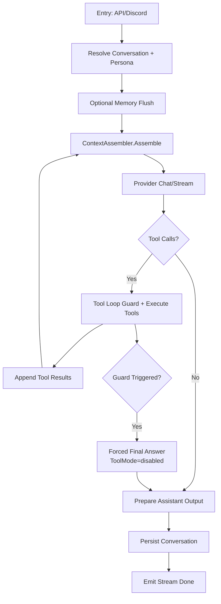

# Chat Pipeline

## Scope
This document describes the runtime path for chat handling in `internal/app`, including tool loop, forced-final behavior, multimodal continuation, and persistence.

## End-to-End Flow

## Module Boundaries
- `chat_service.go`: `ChatService` struct, constructor, tool policy storage, dependency wiring.
- `chat_service_entrypoints.go`: `HandleMessage*` and stream entry methods.
- `chat_service_resolver.go`: conversation/persona resolution and routing.
- `chat_service_memory_flush.go`: pre-compaction flush round and persistence.
- `chat_service_tools.go`: tool execution and persona-bound tool resolution.
- `chat_service_tool_loop.go`: tool loop, duplicate/limit guards, forced-final, fallback.
- `chat_service_multimodal.go`: multimodal history assembly and streaming continuation.
- `chat_service_formatting.go`: prompt snapshots, tool result formatting/compression, display/raw mapping.
- `chat_service_metrics.go`: tool-loop metrics snapshot and token accounting.

## Entry Composition
- `cmd/character/main.go`: entrypoint and high-level orchestration only.
- `internal/bootstrap/runtime.go`: runtime dependency graph construction.
- `internal/bootstrap/provider_init.go`: provider mode init and guarded fallback path.
- `internal/bootstrap/discord.go`: Discord handler assembly.
- `internal/bootstrap/http.go`: HTTP server and API handler assembly.
- `internal/bootstrap/settings.go`: settings loading/defaults and startup validation.
- `internal/interface/api/handlers_settings.go`: settings endpoints only; patch/apply/validation are split to dedicated files.
- `internal/interface/discord/handler*.go`: Discord runtime split by message, stream, context, formatting, and attachments responsibilities.

## Inputs and Outputs
- Input (entrypoint): `channel_id/persona_id` or `conversation_id`, user message, optional images/history entries.
- Internal output: assembled prompt, provider stream chunks, tool results, guard events.
- External output: assistant final text + stream chunks/tool status events.
- Persisted output: user message, assistant content/display/raw, token usage, images refs.

## Behavior Guarantees
- API contracts and SSE event shape remain unchanged.
- Tool guards are deterministic per request via policy snapshot.
- Conversation persistence always occurs at terminal path (normal, tool loop, or forced final).
